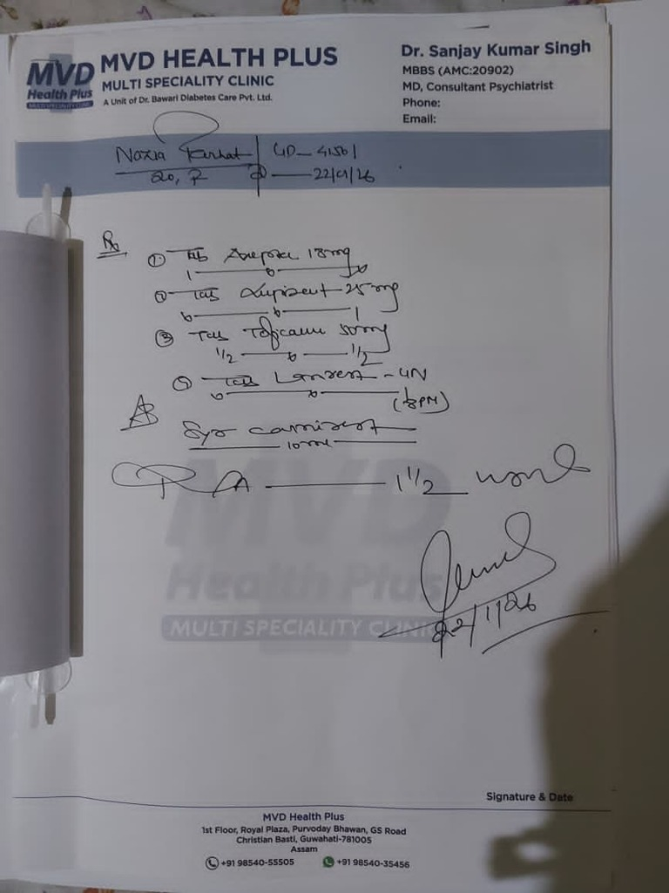

# Araksha: Prescription & Drug Interaction Inspector using Google Gemma 4

[](https://opensource.org/licenses/MIT)
[](https://www.python.org/)
[](https://nextjs.org/)
[](https://fastapi.tiangolo.com/)
[-orange.svg)](https://zenodo.org/records/18478741)
[](https://ai.google.dev/gemma)

**Araksha** is a modular three-tier clinical application (Next.js Frontend, FastAPI Gateway, and Gemma 4 AI Inference Service) designed to protect patients from harmful drug interactions. It scans handwritten prescriptions, grounds messy OCR tokens to standardized medical concepts (**RxNorm**), verifies Drug-Drug Interactions (DDIs) deterministically against medical databases (**TWOSIDES**), and uses **Google Gemma 4** with clinical few-shot annotations (**n2c2**) to produce plain-language, patient-friendly explanations.

---

## 🏛 Architecture & Component Breakdown

```
┌────────────────────────────────────────────────────────┐
│                   CLIENT APPS                          │
│  - Next.js 14 Web (Minimalist, Light/Dark mode)       │
│  - Flutter Mobile (Camera capture framing & chips)     │
│  - React Native / Expo Client                          │
└────────────────────────┬───────────────────────────────┘
                         │ (HTTP / Multipart: Image / Tokens)
                         ▼
┌────────────────────────────────────────────────────────┐
│            BACKEND API GATEWAY (FastAPI)               │
│  - POST /api/v1/prescription/analyze                   │
│  - POST /api/v1/prescriptions/process                  │
│  - POST /api/v1/pipeline/run-all                       │
│  - GET  /api/v1/rxhandbd/samples                       │
│  - GET  /api/v1/drugs/lookup                           │
│                                                        │
│  [Stage 1: OCR Testing Engine]                         │
│    Tested on RxHandBD dataset & real doctor scripts    │
│  [Stage 2: Entity Grounding]                           │
│    RxNorm Concept Table + Levenshtein Token Matcher    │
│  [Stage 3: Deterministic DDI Engine]                   │
│    TWOSIDES & FDA Black Box SQLite/Postgres Store      │
└────────────────────────┬───────────────────────────────┘
                         │ Structured Clinical Payload (No Hallucinations)
                         ▼
┌────────────────────────────────────────────────────────┐
│             AI INFERENCE WORKER (Gemma 4)              │
│  - Model: Google Gemma 4 (via Ollama / vLLM / LiteRT)  │
│  - n2c2 Clinical Event Few-Shot Context Prompts        │
│  - Plain-language translation for everyday patients    │
│  - Mandatory pharmacist checklist & safety disclaimer  │
└────────────────────────────────────────────────────────┘
```

---

## 🔬 Four-Stage Clinical Pipeline

| Stage | Dataset / Source | Format | Purpose |
| :--- | :--- | :--- | :--- |
| **Stage 1: OCR Testing** | [RxHandBD](https://zenodo.org/records/18478741) | Images + CSV | Benchmarks OCR tolerance and segmentation against real doctor handwriting |
| **Stage 2: Entity Grounding** | **RxNorm Concept Table** | SQLite / Dictionary | Normalizes noisy brand names and misspellings to standardized RxCUIs & generic names |
| **Stage 3: Verification Engine** | **TWOSIDES / Clinical DDI Store** | SQLite Table | Deterministic, zero-hallucination query of interacting drug pairs and severities |
| **Stage 4: Gemma 4 Plain Translation** | **n2c2 Medication Annotations** | JSON Prompts | Few-shot clinical guidelines ensuring empathetic, simple English summaries |

---

## 🩺 Dataset Integration

### 1. RxHandBD (Zenodo DOI: [10.5281/zenodo.18478741](https://zenodo.org/records/18478741))
- **Total Dataset:** 5,578 cropped handwritten medical word images by *Md Masudul Islam*.
- **Vocabulary:** 1,769 unique entries including doctor notations, dosage frequencies, and brand names (*Nitrocontive*, *Ciprox*, *Losita*, *Seclo*, *Nexcital*, *Napa*, *Zimax*, *Lasix*).
- **Usage:** Validates OCR character confusion matrix and token match tolerance under noisy, cursive handwriting.

### 2. RxNorm Concept Database
- Standardized dictionary mapping international brand names (e.g., *Coumadin*, *Viagra*, *Lupizep*, *Aripax*, *Toficalm*) to active ingredient concepts (*Warfarin*, *Sildenafil*, *Clonazepam*, *Aripiprazole*, *Tofisopam*).

### 3. TWOSIDES & FDA Interaction Knowledge Base
- Curated deterministic interaction store detailing biological mechanism of action, clinical severity (Severe, Moderate, Caution, Safe), and evidence levels.

### 4. n2c2 Medication Event Annotations
- Clinical dataset formatted into few-shot demonstrations for Google Gemma 4 to translate complex medical pharmacology into understandable schedules and questions.

---

## 🧑‍⚕️ Real Clinical Calibration: Dr. Sanjay Kumar Singh's Prescription

The system includes end-to-end benchmark calibration on a verified prescription from **Dr. Sanjay Kumar Singh** (Senior Consultant Neuropsychiatrist):



### Detected Medications & Extracted Crops
1. **Tab. Aripax 5mg** (`Aripiprazole` - RxCUI 89905)
2. **Tab. Lupizep 0.5mg** (`Clonazepam` - RxCUI 2598)
3. **Tab. Toficalm 50mg** (`Tofisopam` - RxCUI 23789)
4. **Tab. Lonazep 0.25mg** (`Clonazepam` - RxCUI 2598)
5. **Tab. Carnisure 500mg** (`Levocarnitine` - RxCUI 16047)

### Clinical Safety & DDI Findings
- **High-Risk Interaction Detected:** Concurrent prescription of *Lupizep* and *Lonazep* represents **dual benzodiazepine therapy (duplicate clonazepam)**, triggering an immediate alert for additive sedation, motor impairment, and respiratory depression.
- **Gemma 4 Patient Explanation:** Clearly explains the duplicate sedative risk in simple terms and generates an actionable checklist to review with the treating physician or dispensing pharmacist.

---

## 📂 Project Structure

```
Araksha/
├── frontend/                     # Next.js Web Application & Mobile Clients
│   ├── app/                      # Next.js 14 App Router
│   │   ├── layout.tsx            # Global layout with Inter & Outfit typography
│   │   ├── globals.css           # Vanilla CSS design system (Dark & Light theme)
│   │   ├── page.tsx              # Minimalist Patient Scanner & Gemma 4 Report
│   │   ├── ThemeToggle.tsx       # Sun/Moon light mode switcher
│   │   ├── pipeline/page.tsx     # 4-Stage Clinical Pipeline Visualizer
│   │   └── drugs/page.tsx        # RxNorm Medication Directory
│   ├── flutter/                  # Flutter Mobile Client (lib/ & pubspec.yaml)
│   ├── react_native/             # React Native (Expo) Client (App.tsx)
│   ├── public/                   # Prescription crops, RxHandBD samples, assets
│   ├── next.config.js            # API proxy configuration
│   ├── package.json              # Next.js scripts & dependencies
│   └── tsconfig.json             # TypeScript config
├── backend/                      # FastAPI Gateway Application
│   ├── Dockerfile
│   ├── requirements.txt
│   ├── app/
│   │   ├── main.py               # FastAPI entrypoint, CORS, startup seeding
│   │   ├── api/
│   │   │   ├── prescriptions.py  # OCR processing, DDI engine, Gemma 4 dispatch
│   │   │   ├── pipeline.py       # 4-stage pipeline execution endpoints
│   │   │   ├── rxhandbd.py       # RxHandBD dataset sample explorer & benchmark
│   │   │   └── drugs.py          # RxNorm autocomplete lookup
│   │   ├── core/
│   │   │   ├── prescription_calibrator.py # Dr. Sanjay prescription benchmark
│   │   │   ├── rxhandbd_loader.py         # RxHandBD CSV & image ingestion
│   │   │   ├── entity_grounding.py        # RxNorm concept matching
│   │   │   ├── token_matcher.py           # Levenshtein fuzzy matcher
│   │   │   └── twosides_engine.py         # Deterministic DDI database queries
│   │   ├── data/
│   │   │   ├── ddi_store.db               # SQLite DDI knowledge store
│   │   │   ├── rxnorm_catalog.py          # Curated RxNorm brand/generic directory
│   │   │   ├── rxhandbd/                  # RxHandBD Train & Test metadata
│   │   │   └── prescriptions/crops/       # Calibrated prescription crops
│   │   └── services/
│   │       └── gemma_service.py           # Gemma 4 connector with n2c2 prompts
│   └── tests/
│       ├── test_dr_sanjay_prescription.py # Real prescription verification tests
│       ├── test_four_stage_pipeline.py    # End-to-end pipeline integration tests
│       ├── test_rxhandbd.py               # RxHandBD loader tests
│       └── test_api_endpoints.py          # FastAPI TestClient test suite
├── ai_service/                   # Standalone Gemma 4 Inference Worker
│   ├── prompt_templates.py       # n2c2 few-shot clinical formatting & safety prompt
│   ├── gemma_client.py           # Gemma 4 client with deterministic fallback
│   ├── n2c2_few_shot.json        # Few-shot clinical event annotation corpus
│   └── app.py                    # Standalone inference endpoint
└── docker-compose.yml            # Multi-container orchestration
```

---

## 🚀 Getting Started

### Prerequisites
- **Node.js** 18+ and `npm`
- **Python** 3.10+
- *(Optional)* **Docker** & Docker Compose
- *(Optional)* **Ollama** with `gemma:latest` or `gemma4:4b`

---

### Running with Docker Compose (Recommended)

To start the Backend Gateway, Gemma AI Worker, and Database in Docker:

```bash
docker compose up --build
```

- **Backend API:** `http://localhost:8000`
- **Interactive Swagger Docs:** `http://localhost:8000/docs`
- **Ollama Gemma 4 Service:** `http://localhost:11434`

---

### Running Locally (Manual Setup)

#### 1. Start the FastAPI Backend
```bash
cd backend
pip install -r requirements.txt
python -m uvicorn app.main:app --host 127.0.0.1 --port 8000 --reload
```

#### 2. Start the Next.js Frontend
```bash
cd frontend
npm install
npm run dev
```

Open **`http://localhost:3000`** in your browser.

#### 3. Run the Backend Automated Test Suite
```bash
pytest backend/tests/ -v
```

All integration tests will run, covering:
- Dr. Sanjay Kumar Singh's prescription calibration (`test_dr_sanjay_prescription.py`)
- Four-stage clinical pipeline execution (`test_four_stage_pipeline.py`)
- RxHandBD dataset sample ingestion (`test_rxhandbd.py`)
- RxNorm fuzzy grounding & DDI queries (`test_api_endpoints.py`)

---

## 📡 API Reference

### 1. Process Prescription (Main Clinical Flow)
`POST /api/v1/prescriptions/process`

```json
{
  "tokens": [
    { "text": "Warfrin 5mg", "confidence": 0.72 },
    { "text": "Aspirin 81mg", "confidence": 0.95 }
  ],
  "confidence_cutoff": 0.80
}
```

**Response Highlights:**
- `status`: `"success"`
- `risk_level`: `"Severe"` (Color: `red`)
- `detected_medications`: Array with normalized generic names, RxCUIs, and confidence ratings.
- `verified_ddis`: Deterministic database pairs with mechanism and FDA evidence level.
- `patient_summary`: Gemma 4 plain-language translation.
- `pharmacist_checklist`: Actionable questions to ask at the pharmacy counter.

### 2. Analyze Uploaded Image
`POST /api/v1/prescription/analyze`
Accepts `multipart/form-data` with prescription image file. Performs OCR segmentation, grounds items, checks DDIs, and generates plain-language patient summary.

### 3. Four-Stage Pipeline Runner
`POST /api/v1/pipeline/run-all`
Runs the complete Stage 1 (OCR) ➔ Stage 2 (RxNorm) ➔ Stage 3 (TWOSIDES) ➔ Stage 4 (Gemma 4) pipeline on custom tokens or preset scripts.

### 4. RxHandBD Dataset Samples
`GET /api/v1/rxhandbd/samples`
Returns benchmark samples from the RxHandBD handwriting dataset for testing OCR models.

### 5. Drug Autocomplete Lookup
`GET /api/v1/drugs/lookup?q=aripax`
Returns matching active ingredients, brand names, and RxCUIs.

---

## 🛡️ Medical Safety & Ethical AI Principles

1. **Deterministic Verification First:** All drug interaction detections are queried strictly from curated medical databases (**TWOSIDES**, **FDA**). The language model is never permitted to invent, guess, or hallucinate drug interactions.
2. **Empathetic Translation Role:** Google Gemma 4 acts strictly as an empathetic medical translator, converting dense clinical pharmacology into simple 5th-grade reading level advice.
3. **Core Safety Guardrails:**
   - **Never diagnoses** diseases or conditions.
   - **Never prescribes** or adjusts medication dosages.
   - **Never advises stopping** medications abruptly without clinician supervision.
   - Always provides a clear **Ask Your Pharmacist** checklist and mandatory medical disclaimer.

---

## 👥 Contributors & License

- **Authors:** Nazia & Team Araksha
- **License:** Released under the [MIT License](LICENSE).
